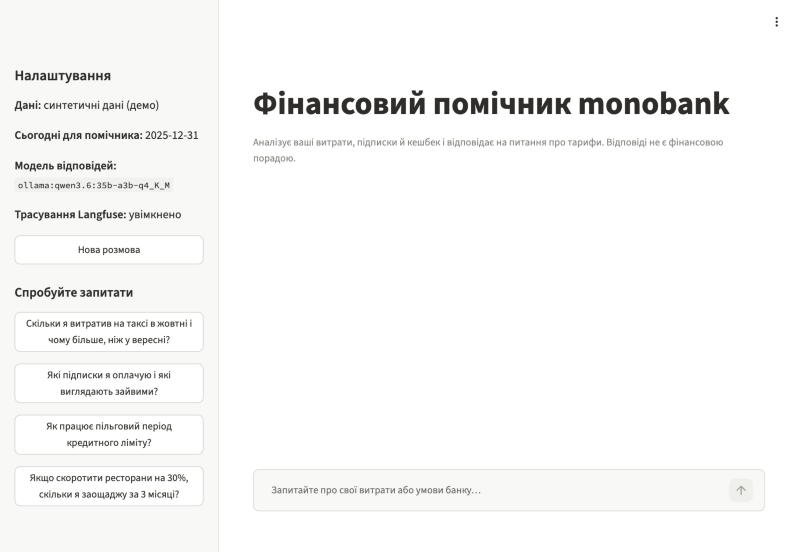
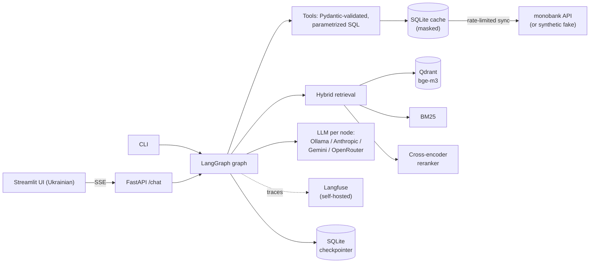
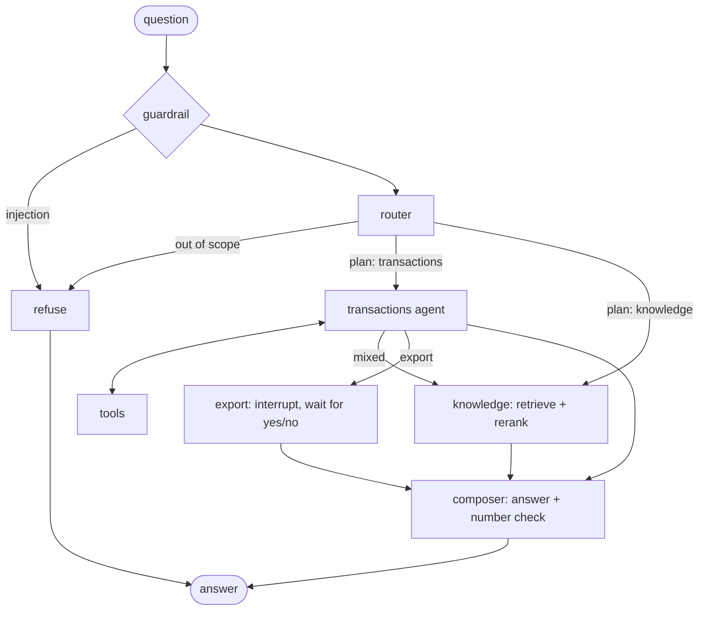
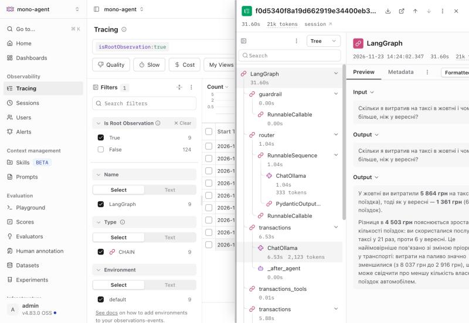

# mono-agent

[](https://github.com/modiepie/mono-agent/actions/workflows/ci.yml)
[](LICENSE)

A LangGraph multi-agent assistant for personal finances on top of the
[monobank Personal API](https://api.monobank.ua/docs/). Ask in Ukrainian or English:

- *«Скільки я витратив на таксі в жовтні і чому більше, ніж у вересні?»*
- *"Which subscriptions am I paying for, and which look unnecessary?"*
- *"How does the credit limit grace period work?"* (answered from tariff documents, with citations)
- *"If I cut restaurants by 30%, how much do I save in 3 months?"*

It runs fully locally (Ollama, Qdrant, self-hosted Langfuse), on **synthetic data by
default**; your real account is an opt-in. Every number in an answer is checked against tool
results by code before the user sees it.



*Real recording of the Ukrainian UI (local Qwen3.6 on a laptop; about 45 s of real time, sped up ~3×):
live progress while the agent compares periods and queries transactions, then an answer whose
numbers all come from tool results.*

## Results

77-question eval over a seeded synthetic year of transactions, numbers checked by code against
ground truth computed independently from the data ([full report](eval/report.md)):

| Setup | Pass | Routing | Tool args | Numbers | Safety | Faithfulness (judge) | Latency |
|---|---|---|---|---|---|---|---|
| **Gemma 4 routes, Qwen3.6 does the rest** | **91%** | 94% | 92% | 93% | 100% | 4.8 / 5 | 13.6 s |
| Qwen3.6 35B-A3B everywhere | 87% | 91% | 94% | 93% | 100% | 4.6 / 5 | 12.7 s |
| Gemma 4 everywhere | 82% | 94% | 88% | 81% | 100% | 4.9 / 5 | 11.2 s |
| Nemotron 3 Ultra (OpenRouter free tier, 12 of 20 core questions) | 83% | 100% | 91% | 90% | 100% | 5.0 / 5 | 26.7 s |

- A question **passes** only if routing, tool calls (name and arguments), every expected number
  and every safety check are right. Safety (out-of-scope, prompt injection in the question, in a
  merchant name, in a transfer comment and in a document, no card numbers or IBANs) is enforced
  by code, so it holds for every model.
- The first full run passed 73%. Reading every failure found real bugs (contradictory filters
  silently returned nothing, Ukrainian text search was case-sensitive, money moves had no
  filter) and router prompt gaps; fixing them took Qwen to 87%. The gain is measured on the same
  questions, so it's optimistic (D41 in [decisions](docs/decisions.md)).
- **RAG ablation** (retrieval only, 21 questions): dense retrieval alone reaches 100% recall@3;
  hybrid BM25 + dense *without* a reranker is worse (MRR 0.65 vs 0.90), because BM25 can't match
  English questions to Ukrainian documents. The cross-encoder reranker recovers it.

## Architecture





The router returns an intent and an **ordered plan** of steps; each step removes itself from the
plan when done, so mixed questions need no special edges. The transactions agent is a
hand-written ReAct loop (max 8 tool rounds).

## Key design decisions

Each has a write-up with alternatives and trade-offs in [docs/decisions.md](docs/decisions.md).

- **No LLM-written SQL.** Seven tools with Pydantic inputs (enums for categories and groupings);
  SQL is built from fixed fragments with bound parameters. Validation errors go back to the model,
  which corrects itself (D14, D15).
- **Numbers are verified by code.** Every number in the answer must appear in tool results,
  documents or the question; one rewrite, then a visible warning (D19).
- **Prompt injection is handled in code, at two boundaries:** user input before any model
  call, and bank/document text before it reaches a prompt (D18, D24).
- **Card numbers and IBANs are masked at ingestion**, so nothing downstream (prompts, traces,
  answers) can leak them (D10).
- **monobank API limits are respected:** a token bucket (1 call / 60 s), 31-day windows, backward
  paging over 500-item pages, retries with backoff, and a SQLite cache that tracks which ranges
  were fetched, so repeated questions never call the bank (D6–D9).
- **Hybrid RAG with every stage switchable** (BM25, dense, RRF, reranker, two chunking
  strategies), measured in an ablation (D25–D29, D35).
- **Eval first:** ground truth computed from the generator, metrics checked by code, an LLM judge
  only for faithfulness, and CI that replays recorded model responses offline (D32–D36).
- **Production concerns:** SSE streaming of progress (the answer is sent only after checks),
  human-in-the-loop export via `interrupt()`, provider fallbacks per node, output caps and
  timeouts, JSON logs, self-hosted Langfuse tracing (D20, D39, D43–D47).

## Quickstart (3 commands)

Needs Docker and [Ollama](https://ollama.com).

```bash
ollama pull qwen3.6:35b-a3b-q4_K_M
```

```bash
cp .env.example .env
```

```bash
docker compose up -d
```

Open http://localhost:8501. The first start downloads the embedding and reranker models
(about 4.5 GB) and indexes the documents; later starts take seconds.

- **Tracing:** `docker compose --profile tracing up -d`, then Langfuse at http://localhost:3000
  (local admin `admin@mono-agent.test` / `local-only-password`, set in `.env`; uncomment the
  `LANGFUSE_*` keys in `.env` first).
- **Your real account:** put your token from [api.monobank.ua](https://api.monobank.ua/) in
  `MONO_TOKEN` in `.env`. Card numbers and IBANs are masked before storage; data stays on your
  machine as long as the models are local. Syncing a year takes about 12 minutes the first time
  (the API allows one statement call per minute); after that it's cached.
- **Other models:** set `ROUTER_MODEL`, `AGENT_MODEL`, `COMPOSER_MODEL`, `FALLBACK_MODEL` to any
  `provider:model` (e.g. `anthropic:claude-sonnet-5-5`, `openrouter:...`) and the matching key.

## MCP server

The seven finance tools are also an [MCP](https://modelcontextprotocol.io) server, so any MCP
client (Claude Desktop, an IDE, another agent) can use them without this project's graph. Same
validation and masking; synthetic data unless `MONO_TOKEN` is set. Note that with real data,
the client's model sees your (masked) transactions.

```json
{"mcpServers": {"mono-agent": {"command": "uv", "args": ["--directory", "/path/to/mono-agent", "run", "mono-agent-mcp"]}}}
```

## Development

```bash
uv sync
uv run pytest                          # 136 tests, no network, no models
uv run mono-agent ask "Скільки я витратив на таксі в жовтні?"
uv run mono-agent chat                 # interactive, conversation memory per thread
uv run mono-agent index                # (re)index data/docs into Qdrant, both chunkings
uv run mono-agent-api                  # API on :8000
uv run streamlit run src/mono_agent/service/ui.py
```

Evaluation:

```bash
uv run python -m eval.run --config local-qwen              # 77 questions -> eval/report.md
uv run python -m eval.run --config openrouter-nemotron --subset core --resume
uv run python -m eval.run --ablation                       # RAG ablation, no LLM
uv run python -m eval.run --config local-qwen --subset smoke --replay   # what CI runs
```



*One question in self-hosted Langfuse: every graph node with its time and tokens.*

## Project layout

```
src/mono_agent/
  mono/        monobank client: token bucket, windows, paging, retries, SQLite cache
  synthetic/   deterministic year of transactions + fake API with the real API's limits
  tools/       7 Pydantic-validated tools, parametrized SQL, MCC categories
  graph/       state, prompts, nodes (guardrail, router, ReAct agent, knowledge, export, composer)
  rag/         HTML/PDF loaders, 2 chunkers, embeddings, Qdrant, BM25, RRF, reranker
  providers/   model per node, fallbacks, token/cost/latency tracking
  service/     FastAPI (SSE), Streamlit UI, CLI, MCP server
  guardrails.py  injection detection, number grounding
eval/          dataset (77 q), ground truth, metrics, judge, ablation, replay, report
docs/          decisions.md (52 design decisions), interview-notes.md
```

## Limitations

- **Synthetic data and placeholder documents.** The tariff documents in `data/docs` are
  illustrative, marked *"not official monobank terms"*; replace them with the real ones.
- **Small eval, one judge.** 77 questions: a 1–2 question difference between configs is noise.
  The judge is a local Qwen that also grades its own answers. A held-out set and an independent
  judge are the next steps.
- **One user at a time.** Shared SQLite connections and one graph run at a time (D44).
- **Multiple cards per currency:** the tools analyse the first account per currency.
- No paid-provider numbers yet (the Anthropic and Gemini configs are ready, but no keys were
  used).

## Docs

- [docs/decisions.md](docs/decisions.md): every design decision: what, why, alternatives,
  trade-offs.
- [docs/interview-notes.md](docs/interview-notes.md): likely questions about this project with
  short answers.
- [eval/report.md](eval/report.md): full evaluation report.

## License

MIT, see [LICENSE](LICENSE). Not affiliated with monobank; "monobank" is used only to name the
public API this project works with.
